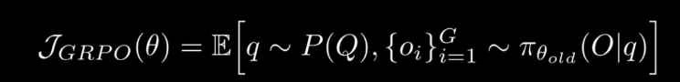
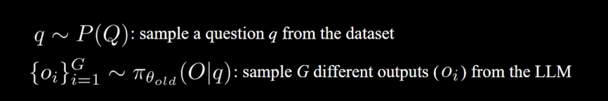
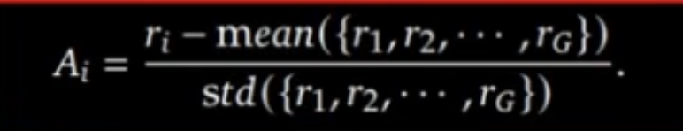

GRPO
Video I'm following: https://www.youtube.com/watch?v=mXWiDU9-fOk
https://arxiv.org/pdf/2402.03300 (GRPO paper) 

## GRPO Objective

The GRPO objective as a function of theta equals the expected value, where q is sampled from the distribution of questions P of Q, and a group of responses o_i from i equals 1 to G is sampeld from the old policy pi subscript theta-old of O given q. 

Remember, theta is the collection of all of the weights and biases. 

An objective function (J) is a mathematical formula that measures how well the AI model is performing its reasoning tasks.

- Objective and loss are just negatives of each other.

By writing q ~ P(Q), you're just saying that every question is NOT equally as likely to be chosen.

The curly braces is just the standard mathematical way to write a set of items.

o_i is a single output response.
G is the total number of responses.
So that set is just like the set of outputs from the model given a specific input.

In the objective function, O is the ENTIRE OUTPUT SPACE. 

So, the right side of the objective is like saying: "We take a sample of G specific resposnes ({o_i}) drawn from the probability distribution of all possible outputs (O) given the question (q)."

The GRPO objective functino is trying to maximize two competing goals at the same time so that your AI model learns how to reason effectively without breaking. 

Ok but if you were

Okay so I just realized that I have a fundamental gap of understanding into how expecations that are if its

## Advantage

Special type of reward/feedback for answering the question q.

How much we should prefer this specific response o_i in comparison to the other responses in this group tha twe sampled for this question. 

"How much advantage does the i-th response have over the others."

advantage = standardized reward

## KL Divergence

Instead of computing the full, exact KL divergence across all possible outputs, they estimate the divergence using the sampled responses o_i for a given question q. 

## Generalized Advantage Estimation (GAE)
It's a mathematical formula used in Reinforcement Learning (specifically in actor-critic algorithms like PPO) to calculate the advantage (A_t) of an action.
The main purpose of GAE is to solve a classic balancing act in machine learning: the bias-variance tradeoff

## Bias-Variance Tradeoff
Is a fundamental concept in ML that describes the tension between two kinds of errors a model can make when trying to learn from data.
1. Bias is the error introduced by a model that is too simple to capture the underlying patterns in the data. High bias leads to underfitting. It makes strong assumptions and ignores important relationships between features.
- Means that the bias is systematically biased toward being too simple; it stubbornly refuses to bend, no matter what the data looks like.
2. Variance is when the error introduced by using a model that is too complex and sensitive to the specific training data it saw. High variance leads to overfitting. The model doesn't just learn the underlying signal; it memorizes the random noise and quirks of the specific training set. 
- The model's predictions vary wildly depending on the exact training data you feed it. If you swap out a few data points, a high-variance model will completely changes its mind an draw a totally different crazy squiggly line. 