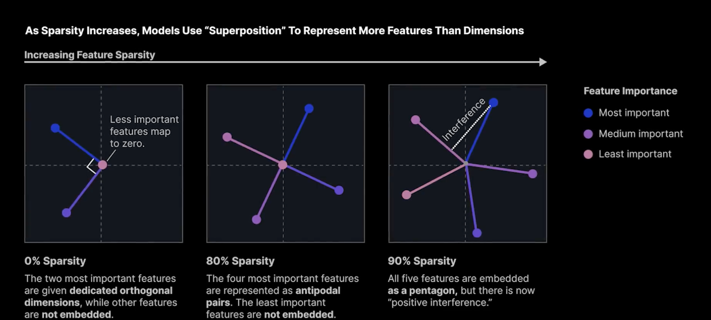

As Sparsity increases, Models use "Superposition" to Represent More Features Than Dimensions
- 

https://transformer-circuits.pub/2022/toy_model/index.html#motivation

Dario Amodei and Lex Fridmen

The leading explanation is superposition: the model wants to represent more features than it has dimensions

https://www.youtube.com/watch?v=JIHOdpj7WM4

The linear representation hypothesis is the claim that neural networks represent features as directions in activation space, and that representations compose additively. 

Two Properties of Linear Representation hypothesis:
1. Readout: a concept's presence can be recovered by projecting the activation onto its direction, which is why linear probes work.

2. Intervention: adding or subtracting that direction changes the concept in the model's behavior, which is the basis of activation steering. 

Some caveates are worth including:
- Superposition: models appear to represent more featurs than they have dimensions, so feature directions 

1:16

How is sparsity measured? 
- Toy Models of Superposition

Antipodal pairs 

Importance of features is determined by how much that they influence the loss, of course.

Is it possible for LLMs to simultaneously have the linear representation hypothesis be true, and also represent more things than they have directions. 

A polysemantic neuron is a single neuron that activates for several unrelated concepts instead of a clean one. 
- This is the neuron-level symptom of superposition. The model has more concepts to represent than it has neurons, so it packs multiple concepts into overlapping directions. Each neuron ends up participating in several featuers and each feature is spread across several neurons. Since features are rarely active at the same time (sparsity), the model can get away with this.

Contrast with a monosemantic neuron: A monosemantic neuron responds to one coherent concept. These exist when a concept is very important or dense